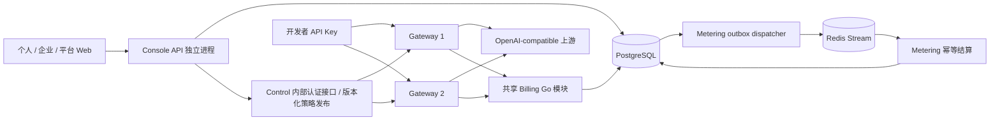

# LLM Gateway：多租户计费平台与生产级面试交付路线

日期：2026-10-01（Asia/Shanghai）\
审查代码：`a38999c18e61e5320ade0db63d4b7ad9011bb2d8`\
目标：在现有流式网关上构建可演示、可压测、可恢复的多租户 LLM 服务平台，包含个人用户、企业管理员和平台管理员 Web UI。

最终审查修订：已收敛 Playground、账本表和任务边界；[审查结论与维护约束](PLAN-REVIEW-2026-10-01.md)记录取舍。

本文是新目标下的建议路线，不表示其中规划功能已经实现。旧 `PROJECT-ROADMAP.md` 保留历史演进背景；实施第一项任务时应统一路线入口，避免两个计划长期竞争。配套文件：

- [压测与故障验收规格](BENCHMARK-AND-ACCEPTANCE-2026-10-01.md)
- [Agent 执行 Prompt 与任务包](AGENT-PROMPTS-2026-10-01.md)

## 1. 路线结论

建议定位为：**面向个人开发者与企业团队的多租户 LLM API 平台，以流式可靠性、权限隔离、余额预占与幂等结算为核心工程能力。**

保留 Go Gateway、Control、Metering、PostgreSQL、Redis 的主体；新增独立 Console API 承载用户/企业/计费管理，Control 保留配置与凭据职责；新增一个 Web 应用承载多角色入口。不重写已经正确的 SSE 实现，不为了展示技术栈新增多个微服务。

推荐顺序：事实和安全基线 → 用户/组织/权限 → 最小 Web 闭环 → 真实价格和账本 → 余额预占及持久结算 → 完整多角色 UI → 多实例与恢复 → 容量实验 → 面试交付。

核心取舍：允许尽早展示 Web 产品，但在计费协议未通过验收前，不声称余额控制和资金准确性已经生产就绪。真实支付、第二种上游协议、Kubernetes、复杂智能路由均不进入首版关键路径。

最终项目要能演示：个人登录并创建 Key；企业管理员邀请成员、限制模型与预算；成员调用 API；价格变更不影响在途请求；余额不足在调用上游前被拒绝；重复计量不会重复扣费；Redis 故障不会导致计费记录消失；跨组织访问被拒绝；管理员查看故障、审计与恢复结果。

## 2. 当前事实与差距

### 2.1 本次调查范围及验证边界

已阅读业务代码、迁移、Compose、CI、压测器、Demo 编排及既有验收报告。初始工作区干净。本次执行 `go test ./... -count=1` 通过，关闭了真实 OpenAI 测试所需的环境变量；测试需要临时本地监听，使用了获准的本地执行权限。源码中有 155 个 `func Test...` 声明，这个数字不是本轮执行用例数量，也不等于所有依赖集成测试均执行。

本次未启动 Docker、未重新运行 Redis/PG 集成测试、race、远端 CI 或压测。既有 2026-09-26 性能数据属于历史证据，不能写成今天重新验证的结果。

### 2.2 已有能力应继续使用

| 领域 | 代码/证据 | 评价 |
|---|---|---|
| SSE 代理 | `internal/proxy`、`internal/provider/openai.go`、`provider/sse` | 首事件前切备、首事件后不重放、取消传播、超时边界已有；最强的面试亮点之一 |
| 配置同步 | `internal/control/sync.go`、`control.go`、`store.go` | PG 版本快照、Get/Watch、旧版本拒绝、原子 patch 已有；继续保持单 Control writer |
| 凭据 | `provider_credentials.go`、`provider_credential_service.go`、`keyhttp.go` | 动态 Provider secret、加密持久化、一次显示 raw API Key、审计已有 |
| 计量 | `internal/metering` | 独立 event ID、重投递去重、ACK 顺序、DLQ、spool、pending 接管已有 |
| 限流 | `internal/limiter` | Redis Lua 令牌桶、Redis TIME、fail-closed、活跃流上限可复用 |
| Demo/CI | `scripts/demo-accept.sh`、`.github/workflows/ci.yml` | 三轮正常/切备/双故障/对账编排及 CI 已存在，不重建第二套 |
| 压测 | `cmd/loadtest`、`scripts/benchmark-local.py` | SSE 完整性、直连对照、资源采样已存在；需修正过载发压和扩展指标 |

### 2.3 当前没有的产品闭环

| 目标模块 | 当前事实 | 需要补齐 |
|---|---|---|
| 多用户 | `Principal` 仅有 admin/tenant-user，使用静态管理 token 或自定义签名 token | 持久化用户、登录会话、退出、禁用、组织切换 |
| 企业管理 | tenant 字符串，没有组织和 membership 数据模型 | 个人组织、企业组织、owner/admin/member/billing_viewer、邀请、移除 |
| API Key 归属 | Key 有 tenant，没有明确创建者、用户归属、模型权限、过期策略 | org/user/key 三层身份、权限投影与撤销传播 |
| 计费 | `CostCents = TotalTokens`，即演示价格；`Balance` 实际为累计消费 SUM | 价格版本、精确金额、钱包、流水、预占、结算、信用调整 |
| 上游成本 | 成功 usage 才有计量事件 | 每次 attempt 的状态、可知成本及未知成本；客户收费与 Provider 成本分离 |
| Web UI | 仓库没有前端项目 | 一个应用、三种角色视角、完整状态反馈和真实 API 接线 |
| 分布式状态 | Gateway report 保存在 Control 内存，无心跳/目标集合 | 活跃实例、配置版本差、撤销 SLA、过期策略 |
| 容量证据 | 本机短流、短轮次 | 长流、慢客户端、开环过载、账本热点、多租户公平性、恢复压力 |

不要把现有 `/ledger/balance` 直接接到“账户余额”卡片：它累计的是消费，不是可用资金。

### 2.4 应先纠正的旧事实与风险

1. `PROJECT-STATUS.md` 中 Consumer 自愈及 pending 一页扫描描述过时：当前 `EnsureGroup` 区分 BUSYGROUP，Run 在 NOGROUP 后重建，reclaim 沿 cursor 每轮最多 32 页；需要关闭旧待办，同时新增“超过一轮分页预算时长期公平性”的验证。当前每个 tick 仍从 `0-0` 开始，大规模病态 pending 是否饿死后部尚未证明。
2. CI workflow 和 `demo-accept` 已有；未确认远端跑绿，不能再把“创建 CI / 三轮 Demo”当作全新建设任务。
3. hot/overflow queue 是易失内存；虽然 spool 写入有 fsync，但只在走到 spool 路径时持久化。客户端 `[DONE]` 已转发、事件尚在内存时 kill -9 仍可能丢记录。**异步队列 + spool 不自动等于成功请求无计费丢失。**
4. 主 Stream 没有完整保留/归档；DLQ 使用近似 MAXLEN 10000，会淘汰未人工解决的记录。正式计费异常必须有 PG 持久状态，不能只在有界 DLQ 中存在。
5. 现有对账全量 XRANGE + Ledger Snapshot，且把 Stream 历史视为完整事实；Stream 做保留后会出现合法 ledger-only。必须先改时间窗口/高水位语义，再执行裁剪。
6. `cmd/loadtest` 的 ticker 后执行阻塞 semaphore。槽满时停止调度到达，开环负载退化；当前固定速率结果只能描述未明显过载的档位。
7. 现有压测采集的“TTFT”是首个非空 data 行，可能是 role-only 事件；没有区分首内容 token，且行解析不是完整多行 SSE event 解析。新报告必须分别定义。
8. Compose 适合本地 Demo；gRPC insecure resolve 显式开启，诊断与业务共 listener，Metering 查询没有用户级授权；宿主绑定 loopback 不等于所有生产访问边界已经解决。
9. 全 Key 集合放版本化快照意味着用户规模扩大后快照/历史与 Watch 成本上涨。首版设容量预算并实测，暂不立刻引入独立身份缓存服务。

## 3. 范围、精简与暂缓

### 3.1 首版必须完成

- 一种 OpenAI-compatible 流式协议，至少两个可控 HTTP 上游；一条小规模真实上游手工验收路径。
- 个人组织与企业组织统一隔离；至少两个企业、每企业多个成员，用户可加入多个组织。
- 用户登录、会话撤销、组织级 RBAC；平台管理权限独立于企业角色。
- Key 创建/列出/撤销/到期、所属组织/用户、模型 allowlist、组织限流策略。
- 输入/输出不同价格、不可变版本、请求固定报价、精确金额、预付款账户、流水、预算告警。
- 并发余额预占、幂等结算、重复投递、缺失 usage、异常挂账、人工调整与审计。
- 用户、企业管理员、平台管理员 Web 工作台，均访问真实后端。
- CI、跨租户负向测试、故障恢复、可复现压测、5 分钟演示。

### 3.2 具体精简动作

| 精简项 | 做法 | 时点 |
|---|---|---|
| 文档事实重复 | README 缩到定位、快速启动、演示、证据入口；STATUS 只写已实现事实；新路线合并成唯一现行路线 | W1 |
| 生产路径的隐式回退 | MemoryLedger、无鉴权、legacy raw-key 输入只留 test/demo 显式 profile；prod 配置缺失启动失败 | W1 |
| 管理 API 散落在 main | 新业务放独立 Console API；已有 Control 配置/凭据入口保留内部兼容，逐模块搬到 service/HTTP handler | W2–W8 |
| 使用累计消费冒充余额 | `Balance` 在兼容接口保持清晰标注，业务新接口用 consumption/available/reserved 命名 | W5 |
| 两套计费可靠性路径 | 正式 billing 的 PG receipt 自带待投递状态，作为逻辑 outbox；旧 spool 仅兼容/遥测，完成切换后不再扩展其资金恢复架构 | W6–W7 |
| 假业务 Mock 混入生产 | 进程外 mock 留在 demo/test profile，Gateway 不隐式注册 | 持续 |
| 三套 UI 项目 | 一个 `web/`，按路由和权限提供视角，共用表格、筛选、错误和状态组件 | W4 起 |
| 超多角色/产品维度 | 首版不做 department/project/workspace 嵌套、角色编辑器和自定义 ACL | 全程 |
| 高基数监控 | tenant/user/key/request ID 主要进日志和查询存储；Prometheus 保留受控 model/provider/status 分类 | W1/W9 |

不要删除历史 migration，也不要把旧 event ID 重写成新 ID。历史验证报告标注版本后保留。只在兼容窗口结束并有迁移证据时删旧入口。

### 3.3 暂缓清单与恢复条件

| 暂缓 | 原因 | 重新考虑条件 |
|---|---|---|
| Anthropic/Responses/工具与多模态完整兼容 | 增大 token 计价与协议边界，稀释核心交付 | 首版闭环验收后，最多增加一种协议 |
| hedging / 智能最低成本路由 | 额外 attempt 会产生上游成本及重复副作用 | attempt 成本有可靠归因，普通路由容量已测 |
| Kafka、service mesh、多 Control writer | 当前收益小，运行和一致性复杂度高 | Redis/单 writer 的瓶颈经实验确认 |
| Kubernetes、多区域、自动扩缩 | 部署能力不能替代资金和权限正确性 | 两 Gateway 实验和完整恢复报告通过 |
| 真实支付/税务发票/多币种 | 引入外部交易与法规边界 | 首版使用沙箱支付或管理员额度调整；需要商业化再独立设计 |
| 自研完整 IAM/SSO/MFA | 消耗较大 | 核心交付后采用成熟 OIDC；首版仅本地认证闭环 |
| Redis 钱包作为最终事实 | 双写/回滚/补偿会扩大资金复杂度 | PG 预占热点锁已明确成为瓶颈且需要更高吞吐 |
| 异步 bounded writer 大改 | 直接背压当前有界，未证明有必要 | 慢客户端实验显示当前策略不能满足目标 |

## 4. 目标架构与边界



Billing 是仓库共享的 Go 模块，初版 Gateway 通过明确接口访问 PG 事务实现，不新增每请求的远程计费 RPC 服务。Metering 承接 receipt/outbox 投递、结算、对账、恢复。Redis 是限流和传输层；账户与收费事实保存在 PG。Control 单 writer；Gateway 可多实例；消费可多实例但更新同钱包时串行事务。

建议新增 `cmd/console`、`internal/console`、`internal/iam`、`internal/organization`、`internal/billing`、`internal/usagequery`、`web/`。用户/企业/账单 HTTP API 接线放 Console API，使用 CloudWeGo Hertz；service 层负责授权和事务，repository 层负责 SQL。已有 auth 用于 API Key；不要把浏览器 session 和开发者 API Key 混用。按照第一个实际模块渐进拆包，不提前建大量空目录。

Web 推荐 React + TypeScript + Vite + Ant Design + React Router + TanStack Query；版本在实施时核验并锁定。这里不需要 SEO 和 SSR，暂不引入 Next.js 服务端。开发用 Vite；部署时 Nginx 托管静态产物并把 /api/v1 代理到 Console API、/v1 代理到 Gateway，设置 SSE 禁止缓冲和明确超时；cookie/session 不需跨域。金额、64 位 ID 通过 JSON 字符串传递，避免 JS Number 精度损失。

### 4.1 进程职责与资源隔离（2026-10-01 补充）

| 部署单元 | 职责 | 独立资源边界 |
|---|---|---|
| web / Nginx | React 静态资源、同源路由、TLS 入口 | 静态资源不占 Gateway 连接/CPU，SSE 路由禁缓冲 |
| cmd/console | 登录、组织/成员、Key 管理、用量查询、价格/账单/调整、后台授权 | 独立 DB pool、请求超时、分页/聚合限额；不在 handler 中执行全量对账 |
| cmd/control | 配置单 writer、Get/Watch、凭据解析、实例状态 | 内部认证 API；不承担用户报表 |
| cmd/gateway | API Key 鉴权、策略、限流、同步余额预占、SSE、终态 receipt 写入 | 独立 DB pool、有限事务超时；无报表/用户管理/cron |
| cmd/metering | outbox、结算、异常恢复、账期任务、分页对账/汇总 | 显式 worker 生命周期、并发限制和任务状态，不绑定用户 HTTP 请求 |

这是同一仓库内的进程分离，领域逻辑仍共享 Go 模块，不拆成多个语言和独立仓库。Console 调用 Control 的认证内部命令接口变更 Key/策略/Provider 配置，不能绕过单 writer 直接写 control_config。只为确实跨进程的策略变更使用 policy_publications 表和幂等业务 ID，显示 queued/persisted/applied；不做通用任务编排系统。组织/成员状态由 PG 权威检查，Key/模型/限流策略由 Control 快照投影。T03 实现 PG access guard，T06 将其纳入余额 admission 的短事务；不声称任何已开始请求会被撤销追溯中断。

Gateway 内余额预占和终态 receipt 持久化是推理链路的同步正确性边界，不是后台任务。Metering 承担异步结算、恢复、周期对账及 policy_publications 补投，都是具体 loop 而非通用 jobs 引擎。首版账单按月份分页查询并汇总，不做自动封账和导出队列；有实测需要再增加汇总任务，不预建 cmd/worker。不同进程仍共享 PG/Redis，必须限制各自 pool/查询时长；独立进程并不能自动消除数据库争用。

验收增加：对 Console 压分页/聚合查询负载时，同时测 Gateway first_content/P99/成功率；Console 重启不打断已有 SSE；管理 DB pool 饱和不耗尽 Gateway pool；PG 共享资源瓶颈仍需监控和限额。框架依据：[React/Vite](https://react.dev/learn/build-a-react-app-from-scratch)、[Ant Design](https://ant.design/docs/react/introduce/)、[Hertz](https://www.cloudwego.io/docs/hertz/overview/)。

### 4.2 HTTP / gRPC / 异步事件通信契约（2026-10-01 补充）

Console API 采用 Hertz；已有 Gateway 的 net/http 和 Control 的 grpc-go 保留。Hertz 是 HTTP 框架，使用它不要求同时迁移 Kitex，也不意味着浏览器接口改成 gRPC。新 Console handler 使用 Hertz 原生 context/中间件，复用 service 业务逻辑；net/http adaptor 只用于少量兼容入口，鉴权/请求ID/metrics须验证传播。不得把未经测试的adaptor用于Gateway SSE热路径，或在异步worker保留可复用的Hertz RequestContext。

| 通信链路 | 首版协议 | 内容 / 状态 |
|---|---|---|
| Browser → Web | HTTPS 静态资源 | React SPA，由Nginx托管 |
| Browser → Console | HTTPS JSON REST + Cookie/CSRF | /api/v1；用户、企业、Key、价格、用量、账单 |
| SDK / 用户 API Key → Gateway | HTTPS JSON请求 + SSE响应 | /v1/chat/completions；维持OpenAI-compatible行为 |
| Browser Playground → Gateway | 同源 HTTPS JSON + SSE，通过 Nginx /v1 | 首版用户输入或使用刚创建的本人 API Key，仅存在页面内存；不存 localStorage，不经 Console 流式代理，不引入委托 token |
| Gateway ↔ Control | 现有gRPC；production mTLS | GetConfig / WatchConfig(server stream) / ReportGatewayStatus / ResolveProviderCredential 已存在；Watch是Gateway发起订阅，不是Control直接请求外网实例 |
| Console → Control | 新增内部管理gRPC，mTLS + 应用授权 | Key/策略/Provider命令、查询发布状态；这是待实现接口，不是现有ConfigService已经具有的能力 |
| Gateway → Provider | HTTP(S) JSON + SSE | 真实供应商接口，不为内部gRPC选型改变上游协议 |
| Gateway → PostgreSQL | PG数据库协议，受限角色/独立pool | 同步admission、receipt/outbox持久化；不经过Console远程调用 |
| Metering ↔ Redis / PostgreSQL | Redis Stream + PG数据库协议 | 异步投递/结算/补投/对账；浏览器不直接访问Metering |
| Console → 用量/账单存储 | PG只读查询 + 资金操作专用事务 | 分页/授权/连接池限制；首版不提供无界导出或通用异步任务 API |

内部管理gRPC元数据带request_id/trace context、operation_id和审计actor/org scope。mTLS验证服务身份，不自动授权终端用户；Control验证Console服务权限和操作scope，浏览器身份不能靠一个任意请求头冒充。actor声明只能来自可信服务通道并留审计。命令采用幂等业务ID/payload digest和expected_version；deadline传播、连接复用，只有明确幂等的操作重试，流式生成不自动重放。

生产外部只公开Web/Console/Gateway；Control与Metering内部接口不直接暴露浏览器。后台状态首版用短周期HTTP查询，不额外引入WebSocket/gRPC-Web。Playground直连现有Gateway SSE，需要验证Nginx禁缓冲、AbortController取消与页面内存Key清理；生成完成才刷新HTTP用量查询。session-only Playground及Hertz流式桥接属于后续扩展。

### 4.3 首版维护边界和固定决策（最终审查）

- 一个仓库，一个Go module；不引入ORM、通用repository基类、CQRS框架、插件式计费引擎或通用工作流。沿用当前PG驱动/迁移工具；共享金额与领域类型放最小包，不让HTTP/Proto DTO成为核心类型。
- Console负责users/sessions/orgs/memberships/invitations、读模型和平台credit调整；Control负责api_keys、策略/Provider/credential和control_config；Gateway只执行access guard/admission/finalize；Metering只执行投递、结算、恢复和发布补投。共享PG是首版明确边界，每个模块有唯一写入入口并授最小数据库权限。
- Control新增Key事实表时，Key metadata/hash、成功审计、配置快照和operation结果同PG事务；快照只是派生投影。Console不维护第二份可编辑Key事实，不直接写control_config。
- IAM状态更新与policy_publications在同Console事务；worker只处理具体发布类型，带org_revision且按组织顺序收敛。旧revision不能覆盖新状态；gRPC超时结果按operation ID查，不盲目重新生成命令。RPC期间不持有PG锁。
- receipt业务字段/digest不可变；派发重试字段可变但不参与业务digest。formal billing只处理新版本receipt，legacy计量只展示历史累计消费，不自动转成钱包debit。切换停旧写者并验明事件版本，不支持无设计的新旧运行时混跑。
- 生产新增PG访问角色/池、具体配置默认值/缺失行为以及proto生成工具版本都随任务给出；本地bootstrap和迁移runbook可复现，不能只提交业务包。
- 模型权限按org allowlist ∩ member限制（若配置）∩ Key限制（若配置）计算，子级不能扩大父级权限；省略限制为继承，显式空集合为deny-all，API/Proto保留该区别。RPM首版只做org级，不实现多层令牌桶。PG access guard同时检查当前member角色，降为billing_viewer后旧Key也不能生成。
- 最后owner保护需要组织级短事务串行化；两个owner并发移除/降权不能都看到旧count而成功，必须有真实PG并发用例。
- 首版固定billing_viewer只读；组织钱包硬admission、成员预算软告警；成员硬钱包/预算、角色叠加、分布式并发租约和自动封账全部延后。
- 全局活跃流上限明确为每Gateway实例；组织并发首版也是每实例保护，RPM令牌桶共享Redis。两实例时可用上限可能相加，UI/报告不得叫跨实例全局硬配额；只有公平性实验证明必要才增加分布式配额。
- Key secret只显示一次：CreateKey响应丢失时可按operation ID查询已创建的metadata，不能重新取得secret；提示撤销该孤儿Key并重新创建。自动重试不得返回/日志记录旧secret，不能为幂等把明文secret持久化。
- API契约分阶段冻结：T02冻结会话/组织；T03冻结成员/Key/最小本人usage；T05冻结价格/账户/流水；T06冻结receipt状态；T08完成页面，不等待T02设计全部未来接口。
- 现有`ChatStream(..., io.Writer) -> Usage`是在流结束后才返回usage；T06必须在完整SSE event边界增加最小终态gate/回调，不能在字节字符串上替换[DONE]，也不能只在ChatStream返回后才保存receipt。T06A先以组件实验验证此接口再建资金链路。

## 5. 领域模型、权限和 API

### 5.1 核心实体

| 实体 | 最小字段/约束 |
|---|---|
| users | id、email 唯一、password_hash、status、created_at；不存明文密码 |
| sessions | hash(token)、user_id、expires_at、revoked_at、认证版本；浏览器存随机不透明 cookie |
| organizations | id、type(personal/enterprise)、name、status；个人 org 与 user 唯一关联 |
| memberships | org_id + user_id 唯一、role、status；最后一个 owner 不可删除/降权 |
| invitations | org_id、规范化 email、token_hash、role、expires_at、accepted_at；接受邀请不能重复加入或篡改角色 |
| api_keys | id、hash、prefix、org_id、owner_user_id、created_by、status、expires_at、policy_version |
| policies | org/key 模型 allowlist、RPM、burst、并发上限、预算模式；用户预算首版为 soft policy |
| price_versions | model、currency、输入/输出整数价格、计价单位、effective_at、immutable version |
| billing_accounts | org_id 唯一、currency、posted_balance_micro、reserved_micro、status、version |
| billing_executions | execution_id 唯一；同时保存执行身份、reservation金额/状态、org/user/key、price_version、gateway_id、恢复时间；不再建独立executions和reservations表 |
| usage_receipts | execution_id/event_id 唯一、prompt/output、usage状态、policy/price版本、金额、发生时间、digest；附dispatch_after/claim_until/attempts/settled_at，作为逻辑outbox |
| billing_entries | append-only，account、business_id + kind 唯一、amount_micro、direction、reason、operator |
| request_attempts（暂缓独立表） | 首版attempt写结构化日志与有界指标；最终receipt记可知Provider成本/unknown；不强求失败attempt完整供应商成本账本 |
| billing_periods/statements（暂缓独立表） | 首版按账本posted_at月份实时汇总；标明账单截至时间，迟到结算归实际入账月；正式封账/历史修订后续独立实现 |
| policy_publications | org/revision唯一、目标scope、状态、attempts/next_retry；只处理业务策略传播，不支持任意任务类型 |
| audit_events | actor、org、action、target、outcome、request/trace ID；不记录 secret 或 prompt 正文 |

所有组织资源带 org_id；查询使用 `WHERE org_id = authorized_scope`，不是取出后才过滤。跨组织外键尽量使用组合约束，避免把 A 企业的 Key 接到 B 企业的用户/账单。PG RLS 可作为后续第二道防线，不能替代服务授权；首版先完成服务层与 SQL scope 的强制约束。

`tenant_id` 的目标语义就是 org_id，不同时引入另一套独立 tenant 层。旧 tenant-demo 通过明确映射导入组织；新 Key 和事件包含 owner_user_id/key_id，旧数据保留 legacy 未知归属，禁止伪造历史用户。数据库迁移采用扩展字段 → 双读/新写 → 回填 → 校验 → 停用兼容入口，不在已有 migration 中直接改历史定义。

### 5.2 权限矩阵

| 操作 | member | billing_viewer | org_admin | org_owner | platform_admin |
|---|---|---|---|---|---|
| 使用获准模型 | ✓ | — | ✓ | ✓ | 通过显式组织身份，不自动绕过收费 |
| 管理本人 Key / 本人用量 | ✓ | — | ✓ | ✓ | 显式支持操作 |
| 查看企业总用量和账单 | — | ✓ | ✓ | ✓ | 审计的支持入口 |
| 邀请/移除普通成员 | — | — | ✓ | ✓ | 显式支持操作 |
| 修改成员模型/限流策略 | — | — | ✓ | ✓ | 显式支持操作 |
| 创建 admin / 移交 owner | — | — | — | ✓ | 应急操作需原因及审计 |
| 调整钱包额度 | — | — | — | — | ✓，整数金额、理由、幂等键 |
| 管理 Provider / 价格 / 系统配置 | — | — | — | — | ✓ |

首版 billing_viewer 固定为只读财务角色：可看本组织账单/企业汇总，不生成请求、不创建Key、不改成员或配置；个人资料权限独立于财务角色。需要调用时由owner改为member/admin，首版不实现角色叠加。企业管理员不得提升为平台管理员。UI 隐藏按钮只是体验，所有检查都必须在服务端。组织暂停和用户移除应禁止后续 Key 使用，不能只影响网页登录。

撤销采用“提交/传播中/生效”状态，不能创建或撤销成功后立即宣称所有 Gateway 已同步。Key/模型策略目标：健康 Gateway 在 5 秒内拒绝新调用；管理/策略失联超出 30 秒租约后拒绝新调用。成员/用户/组织禁用走 PG access guard，按授权读取/短事务提交时刻定义 admission；与禁用并发且已获准的请求允许排水，不混称为所有权限都依赖5秒传播。已有流首版继续排水；如果需要强制中断，另设显式操作。

### 5.3 API 契约建议

以下均是待实现的 v1 管理 API，不是当前已存在端点。

```text
POST   /api/v1/auth/login | logout
GET    /api/v1/me
GET    /api/v1/organizations
POST   /api/v1/organizations                  # 创建企业；个人 org 自动创建
GET    /api/v1/orgs/{org}/members
POST   /api/v1/orgs/{org}/invitations
POST   /api/v1/invitations/{token}/accept
PATCH  /api/v1/orgs/{org}/members/{user}
DELETE /api/v1/orgs/{org}/members/{user}
GET/POST /api/v1/orgs/{org}/keys
POST   /api/v1/orgs/{org}/keys/{key}/revoke
GET    /api/v1/orgs/{org}/models
GET    /api/v1/orgs/{org}/usage                 # member 自动限定本人
GET    /api/v1/orgs/{org}/requests/{execution}
GET    /api/v1/orgs/{org}/billing/account
GET    /api/v1/orgs/{org}/billing/entries
GET    /api/v1/orgs/{org}/billing/statements
GET    /api/v1/orgs/{org}/audit
GET    /api/v1/admin/organizations | users | gateways | billing/exceptions
POST   /api/v1/admin/billing/accounts/{id}/adjustments
GET/POST /api/v1/admin/prices
```

API 使用统一 `error.code/message/request_id`；区分 unauthorized、forbidden、rate_limited、insufficient_balance、config_pending、billing_unavailable。错误示例和 OpenAPI 在 W2 确立。金额写操作接受 Idempotency-Key：服务端按 actor/org/operation scope 存请求摘要和结果，相同键不同 payload 返回冲突。它不沿用客户端 X-Request-ID，也不暗示生成请求可以任意自动重试。

列表游标分页并设最大页尺寸；过滤排序列白名单。报表使用 UTC 存储，UI 展示 Asia/Shanghai，可显式切换时区。首版账期按 UTC 月定义并在 UI 标出，避免按页面本地时区重复/遗漏边界数据。Statement 首版是按入账月份实时查询的内部消费报表，不自动封账，不称法定发票；occurred_at用于用量分析，posted_at用于资金账单，两者不可混用。

登录首版：管理员初始化用户 + 企业邀请注册；无公开自助注册/发邮件系统。邀请链接由管理员复制，Demo 明确显示模拟邮箱未验证。采用成熟密码哈希实现、登录节流、HttpOnly/Secure/SameSite cookie、CSRF token、固定过期会话；登出/密码变更/用户禁用可使服务端会话失效。SameSite 不替代 CSRF 防护，依据 [OWASP Session Management](https://cheatsheetseries.owasp.org/cheatsheets/Session_Management_Cheat_Sheet.html)。

## 6. 计费设计：先说清承诺，再实现优化

### 6.1 价格和精度

- 首版只使用 CNY；账本单位为微元（10^-6 元），使用 int64，禁止 float64 金额。
- 价格定义为每一百万输入/输出 token 对应多少微元，输入输出独立。
- `charge_micro = ceil((input_tokens * input_price_micro_per_million + output_tokens * output_price_micro_per_million) / 1_000_000)`；合并后只舍入一次，防止逐 token/逐批累计舍入误差。乘法需要检查溢出或使用大整数。
- 展示到分时可格式化，但内部不能提前截断到分；价格和金额以十进制字符串传 Web。
- price_version 在 admission 时固定；receipt/outbox 重放使用原版本。价格更新创建新版本，不覆盖旧值。
- 旧 CostCents 保留 legacy 价格来源；不要按新价格重算历史已计费数据。
- 拆分 list price、客户 charge、provider cost；失败 attempt 不一定向客户收费，但可能有供应商成本。未知成本显式 unknown。

### 6.2 余额和预算不要混淆

`available = posted_balance - reserved`。管理员充值/赠送额度是 credit entry；消费是 debit entry；修改金额通过反向调整流水，不 UPDATE 历史金额。账户行是性能投影，账本为可审计事实；每次变动同事务更新两者。

首版选 **组织钱包硬 admission、成员月预算软阈值**。软预算可延迟几秒并允许明确的有限超额，UI 写明“告警阈值”。如果成员预算必须硬限制，需要在同一个 admission 事务同时锁定组织账户和预算 bucket，并按固定锁顺序处理，增加一条验收任务，不得以 Redis 计数器冒充资金限额。

### 6.3 Admission → receipt → settlement

1. API Key解析获得org/user/key/policy；T03的PG access guard验证用户/成员/组织有效，快照验证Key状态/模型/到期；T06将guard纳入短admission事务。
2. 固定价格版本，计算 reservation。缺少输出上限的计费请求采用明确平台上限并改写/校验 `max_tokens`；首版仅开放已验证计价的文本模型。
3. PG 事务对账户条件更新/行锁，检查 available，创建 execution/reservation，增加 reserved；余额不足不调用上游。事务失败不启动流。
4. 按现有 SSE 边界执行路由。attempt 的业务身份保持 execution_id 稳定，每个 attempt 单独编号。
5. 上游完成且usage有效后，**在向客户端转发 `[DONE]` 前**，以独立且有界的持久化阶段写 usage_receipt，并将 billing_executions 改为 receipt_recorded；receipt自带待投递状态，两者同事务提交，不再建独立billing_outbox表。不等待最终结算，只暂缓结束event。
6. Outbox dispatcher 把 receipt 发送 Redis Stream；投递后标记不是“永远不需要重投”。Settlement 对 event_id/business_id 幂等，事务内写 debit、释放 reservation、更新账户；事务提交后 ACK。
7. PG receipt/outbox 保留未结算记录；即使 Redis 在投递后丢数据，定期按 receipt settlement 状态补投仍可恢复。Redis 不能是唯一计费事件事实源。
8. 若最终持久化确认失败或结果不确定，不转发完整 `[DONE]`；已发HTTP 200时只能终止流并记录incomplete，不能事后改HTTP状态。保留reservation，按同execution ID回查/重试，不透明重放Provider。PG此刻不可写时，已有billing_executions是恢复锚点；不能假称已写入新异常。客户端断线后仍尝试独立有界finalization。

PG 事务原子性用于保证资金更新；行锁或条件更新的实际方案要结合热点实验选择。并发更新边界参考 [PostgreSQL 数据一致性文档](https://www.postgresql.org/docs/current/applevel-consistency.html)。首版采用 PG 默认持久提交配置并记录运行设置；客户端或deadline超时不证明COMMIT回滚，重试/回查保持相同execution/business ID；单机数据库仍不能承诺机房故障/磁盘损毁的零丢失。

**预占上界不能靠“估一下”就宣称严格不透支。** 文本模型的输入计数应使用该模型可信 tokenizer 或已证明的保守上界；平台限制 messages/内容类型/输出上限。无法获得严格上界时，系统只能承诺 admission 资金约束和显式有限风险。真实 usage 超过 reservation 的事件仍按确定政策计入应收/债务并暂停账户，不能静默截断费用或伪造零透支。Demo 使用精确可控 Mock 证明 strict bound 分支；真实模型未验证的 token 上界必须列为限制。

### 6.4 失败状态机

```text
reserved → executing → receipt_recorded → settled
                   ↘ failed_no_charge → released
                   ↘ usage_unknown → review_required → settled / adjusted / released
```

| 场景 | 客户计费策略 | reservation 处理 |
|---|---|---|
| 首事件前全部 Provider 失败 | 不收费，attempt cost 可 unknown | 有终态失败证据后释放 |
| 主失败、备成功且有 usage | 最终成功执行收费一次 | 结算并释放剩余预占 |
| 上游完成前取消 / 首事件后断流 | 无成功receipt时首版客户不收费，usage不可知留异常 | 已确认取消终态后按策略释放；未知执行先review，供应商成本可unknown |
| receipt提交后客户端断线 | 按receipt正常收费 | delivery失败不撤销资金事实 |
| `[DONE]` 但 usage 缺失/非法 | 不当作已结算零消费 | 持久 exception，告警、保留预占待处理 |
| Consumer PG 写成功、ACK 丢失 | 不重复扣款 | 唯一约束 + 事务状态守卫 |
| reservation 超时 | 超时只触发恢复调查，不等于可释放 | 确认 execution 终态或审计释放 |
| 用户删账号 / 成员被移除 | 历史用量继续存在并结算 | 不能 cascade 删除资金事实 |
| 价格变更 | 在途按 admission 原价 | reservation/receipt 保留原版本 |

客户收费以“上游完成、usage有效且receipt持久化”为依据，不以客户端确认收到[DONE]为依据。receipt提交后客户端断线仍结算；final write失败只改变delivery_status，不能回滚已确认费用。上游在完成前中断/取消且无成功receipt，首版按平台不收费政策处理；usage未知必须留异常。UI分别显示execution/settlement/delivery状态。供应商成本未知不等于零成本，不承诺所有成本均可准确计回。

### 6.5 恢复和对账

对账至少四层：execution/reservation 终态 → receipt/outbox → billing_entries → account projection。以 PG 事实及高水位/时间窗口比较；Redis Stream 只是传输检查，归档后不能要求所有历史事件还留在 Redis。

异常恢复首版设24小时人工处理SLA。僵尸reservation只有在gateway实例失活、最大attempt时长+恢复宽限已过、同execution不存在成功receipt、恢复检查记录完成后，才能按“平台承担未知上游成本、不向客户收费”政策有审计地释放；不能仅凭TTL。成功receipt永不因客户端断线进入此释放路径。恢复释放与finalize必须对同execution做事务内状态守卫/互斥；released不能再提交可收费receipt或发DONE，迟到usage进入异常审计。人工释放/结算也走同一状态机，不能直接改reserved余额。

Stream 裁剪必须考虑所有消费组 ACK、结算记录可恢复、异常已持久保存。Redis 提供不同 pending 引用处理选项，实施前核对当前版本行为；不能盲目 MAXLEN 丢业务事件，参考 [Redis XTRIM](https://redis.io/docs/latest/commands/xtrim/)。保留策略建议：Redis 热数据 24–72 小时，PG receipt/账本在面试数据集期间保留；30 天请求明细、90 天用量汇总先作为配置设计，不当作法规规定。

## 7. Web UI 交付范围

### 7.1 个人/成员视角

登录/组织切换；概览；模型目录；本人 API Keys；本人用量和请求详情；个人组织账单；Playground。

概览显示可用/预占资金、当前周期消费、最近请求成功/断流、结算延迟。Key 创建弹窗只显示 secret 一次，刷新不恢复，列表只有 prefix；Playground 支持 AbortController 取消、明确模型价目与 token 上限。Playground直接通过同源/v1调用Gateway，用户输入本人API Key或使用刚创建的Key，仅在页面内存持有，切组织/退出/离页即清理。禁止持久化Key或把Provider secret/平台token放前端；不建Console流式代理和短期委托协议。

### 7.2 企业管理员视角

企业概览；成员/邀请/角色；成员和企业 Key；模型权限与限流；按成员/模型的消费分解；余额/流水/用量账单；审计。

至少完成：邀请成员、移除后新调用被拒绝、成员 A/B 用量分开、企业余额共享、billing_viewer 只读、最后一个 owner 保护。图表只展示能查询出的真实数据，不填随机漂亮数字。

### 7.3 平台管理员视角

组织/用户列表和状态；Provider/凭据引用；模型价格版本；配置 desired/applied/rejected/stale；充值/调整；计费异常、DLQ 与恢复；系统健康和审计。

充值显示“管理员额度调整”，不伪装微信/支付宝支付。凭据列表不显示明文，配置提交后展示传播状态。修复账单必须有理由、幂等键、前后结果，操作自动写审计。

### 7.4 共用质量要求

桌面 1440 和窄屏 390 检查；列表分页/日期过滤；loading/empty/error/stale/forbidden 五类状态；失败消息含 request ID；金额和时间口径统一；关键操作可键盘访问；危险操作显示明确对象；cookie 退出后不可继续请求。Playwright 覆盖三类角色，不以截图或按钮隐藏代替 RBAC 验证。

## 8. 时间表和阶段出口

假设一名开发者，每周有效投入约25小时（包含Agent审查与验证），2026-10-05开始。最终审查后，12周/300小时只作为顺利情况下的目标；更稳妥的工作预算为350–450小时，即14–18周，包含2–6周恢复/安全/资金联调缓冲。日期是排期基线，不是可靠性保证；如果每周只有 10 小时，按 2.5 倍延长。只有出口通过后才开始依赖模块。

| 周 | 日期 | 主交付 | 验收出口 |
|---|---|---|---|
| W1 | 10/05–10/11 | 事实清理、安全 profile、错误和指标口径、基线 | 本地回归/依赖集成/CI 证据；prod 无隐式回退；旧待办不重复 |
| W2 | 10/12–10/18 | 独立 Console API、用户、个人/企业组织、会话、API 契约 | 登录/退出/禁用；组织切换；不可伪造 scope |
| W3 | 10/19–10/25 | 成员邀请/RBAC、Key 归属、权限策略投影 | 两企业隔离；owner 保护；撤销状态可见；API 集成用例 |
| W4 | 10/26–11/01 | 第一版真实 Web：登录、组织、Key、模型、本人用量 | 三身份最小导航与用户调用闭环，E2E 通过；M1 |
| W5 | 11/02–11/08 | 精确价格、不可变 price version、账户/流水、legacy 迁移 | 小额价格/舍入/溢出/历史价格/重复调整可验证 |
| W6 | 11/09–11/15 | PG 余额预占、receipt/outbox、DONE 持久边界 | 并发不能重复使用同余额；成功终态有 durable receipt |
| W7 | 11/16–11/22 | 幂等结算、挂账、重投递、账单/分页对账 | ACK 丢失/进程崩溃/Redis 丢传输数据可恢复；零重复扣款 |
| W8 | 11/23–11/29 | 企业和平台完整 UI、余额/流水/审计/异常入口 | 邀请→调用→收费→查看→调整垂直闭环；M2 |
| W9 | 11/30–12/06 | 两 Gateway、心跳/策略租约、动态限流/公平性 | 撤销 5 秒目标；stale 实例拒新调用；共享钱包无超额放行 |
| W10 | 12/07–12/13 | 故障/恢复/慢客户端/安全矩阵，备份恢复演练 | 关键故障无无归属资金状态；恢复时间与数据差异可追溯 |
| W11 | 12/14–12/20 | 开环压测、A/B 对照、热点账户容量、profile | 容量拐点和瓶颈证据；未提升也如实报告 |
| W12 | 12/21–12/27 | 发布候选、README、演示、设计复盘、面试材料 | 全量验收通过；5 分钟 Demo；M3 |
| Buffer | 12/28–2027/02/07（2–6周，按出口滚动） | 仅关闭出口缺口和必要修复 | 不新增协议、支付或部署平台 |

### 8.1 三个里程碑

**M1（W4）：多租户产品骨架。** 三角色入口已可操作，Key 权限与企业成员隔离成立；消费页可用但金额明确是旧演示口径。可提前面试展示 SSE 与权限，不能声称正式计费完成。

**M2（W8）：完整资金与产品闭环。** 价格/余额/预占/结算/账单/审计、三视角 UI 全部接真实 API；kill -9/ACK 重投递有基本证据。此时冻结新业务范围。

**M3（W12）：生产导向验收交付。** 多实例、故障矩阵、容量实验、安全 profile、备份恢复、CI 和演示材料完整。简历称“生产导向多租户网关平台”，明确真实支付、HA PG、多区域不在范围。

### 8.2 第一个星期的具体执行顺序

1. 半天：对照 HEAD 重写状态清单，建立能力/限制/证据索引；明确本路线为实施顺序。
2. 一天：prod/demo/test 显式配置；prod 检查 PG/管理认证/mTLS/secret/诊断 listener；默认失败而非偷偷降级。
3. 半天：错误 schema、请求入口计数、首事件/首内容指标术语，消除报表口径歧义。
4. 半天：建立隔离基线runner，短流仅做低负载对照；开放到达调度、长流/慢客户端工具在T01B（W10）完成，W1不先建完整压测平台。
5. 一天：现有回归/集成/Demo 固化一次新基线；保存版本、环境、已跳过测试；不为了“创新”重写已有测试。
6. 一天：写 IAM/组织/Key/资金 ADR 和 OpenAPI 首版，审查跨租户及资金字段；准备 W2。

### 8.3 超期时的删减顺序

依次删：花哨图表/动画 → 自助注册和邮件发送 → 多粒度预算 → 月账单高级导出 → 第二协议 → Kubernetes/真实支付。不能删：授权负向测试、余额并发、结算幂等、成功事件持久边界、故障证据。若计费任务超过已分配的2–6周缓冲，应公开缩成“精确计量 + 软预算”，不把不完整预付钱包包装为资金系统。

## 9. 工程验收与可观测性

### 9.1 系统不变量

- 请求：首事件后不切备重放；取消不继续新 attempt；流完整性不由 HTTP 200 单独判断。
- 身份：请求 scope 由 session/Key 与 membership 导出；跨 org 无可见数据；禁用/撤销不会被旧版本恢复。
- 配置：PG persisted 不等于全实例 active；心跳超时显示 unknown/stale；单 writer 明确。
- 金额：整数价格；同 execution 只结算一次；同 adjustment 只记一次；价格变更不重算历史。
- 余额：同钱包 admission 原子；reservation 不能到期就盲目释放；可用余额、预占、流水可对账。
- 持久性：正式计费成功终态在 `[DONE]` 前有 durable receipt；receipt/outbox 可重投；PG 失败不绕过 admission。
- 运维：资金异常在 PG 有终态或待处理状态；不能只靠日志/DLQ/内存留证。

### 9.2 指标与查询

入口请求总数覆盖鉴权/限流/余额拒绝，按 result_class 统计；completed/incomplete/cancelled 分开。记录 first_event、first_content、duration、chunk_gap、attempt count、active streams。

资金指标：admission/settlement 延迟、账户行锁等待、reservation age、receipt 到 settled lag、outbox oldest age、dedup/conflict count、exception 未处理数、账本与投影差异。组织/成员消费用 SQL 查询和汇总表，不把每个用户塞到 Prometheus 标签。

初始 SLO 是验收目标、不是已测结果：稳定负载完整流成功率 ≥99.5%；计费 receipt 到可见结算 P99 ≤5 秒；正常配置传播 P99 ≤5 秒；所有跨租户负向用例通过；重复扣款为 0；确定性 Mock 的未解释资金差异为 0。首事件延迟和内存阈值按配套压测文档、固定硬件测量确认。

### 9.3 CI 分层

每 PR：普通测试/vet/build、关键 package race、migration/Redis/PG 集成、frontend typecheck/build、关键 RBAC/账本/E2E。夜间/手动：完整 race、故障恢复、短性能 smoke。稳定 Linux 专机：容量与长时间压力。性能不要作为共享 GitHub runner 上的硬性毫秒门槛。

备份恢复演练：新隔离环境导入 PG 备份，恢复价格/账本/组织/凭据密文，校验 secret master key 依赖和账户投影一致性；不能把只“备份文件生成成功”当恢复验收。记录 RPO/RTO 实测，禁止对未做 HA 的单机声称无损灾备。

## 10. 压测推进与 A/B 方向

AB 有两种含义，路线都覆盖：ApacheBench 用于普通管理 HTTP；A/B 对照实验用于直连/网关、前后版本和不同可靠性策略。SSE 主测继续扩展本项目 loadtest，不能用 ApacheBench 总耗时替代首 token/断流/usage/最终收费验证。工具用途参见 [ApacheBench 官方说明](https://httpd.apache.org/docs/2.4/en/programs/ab.html)。

| 时点 | 实验 | 决策 |
|---|---|---|
| W1 | 明确现有口径限制；隔离低负载直连/Gateway 基线 | 保证后续数字可比较 |
| W5 | ledger 查询分页/索引 A/B，小额计价吞吐 | 决定是否需要日汇总，不凭直觉上缓存 |
| W6–W7 | 原型/正式 admission + DONE receipt 对照；单账户/多账户 | 量化 PG 正确性成本和热行瓶颈 |
| W9 | 一/两 Gateway，组织噪声邻居、共享限流与钱包 | 判定扩容提升是否被 PG/Redis 热点限制 |
| W10 | T01B开放到达工具、慢客户端、断流、依赖故障、kill -9 | 量化退化、RTO、资金异常闭环 |
| W11 | 稳定 Linux：速率阶梯、长流、soak、profile 优化 A/B | 找拐点；只优化被证据确认的瓶颈 |

现有 300 RPS 结果不是目标容量：每流约 140ms，估算活跃流只约 42；若每流 10 秒，同样 300 RPS 需要约 3000 活跃流，远超现有 256 默认上限。项目容量必须同时报告到达率、活跃连接与平均流时长。详细场景、负载、门槛、命令模板见配套文件。

## 11. 风险与面试价值

| 风险 | 判断和处理 |
|---|---|
| 账本热点限制吞吐 | 先用 PG 保正确；单组织/多组织对照，测锁等待；不能靠移除预占刷漂亮吞吐 |
| 部分流无法得知真实 usage | unknown 独立状态，保留预占、恢复/人工调整；已知限制和运营风险透明 |
| 全量 Key 快照 | 先测 1k/10k Key 的传播/内存；达到预算再做增量，不提前换架构 |
| 状态同步与成员撤销 | 权限版本+心跳租约；默认健康 5s，失联 30s 拒新请求；安全和可用性取舍写 ADR |
| Web 吃掉可靠性时间 | 一套应用，先关键表格和真实闭环；业务 W8 冻结 |
| Agent 改动过大 | 一个任务一个垂直闭环；scope/验收/证据/非目标提前固定；迁移和资金状态先设计后编码 |

项目讲述建议围绕四个深度案例，而不是背功能列表：

1. SSE 为什么首事件后不能重放，如何在已经写出 token 后完成计费终态。
2. 为什么 at-least-once + 唯一 event ID 还不等于客户成功绝不丢账，为什么引入 durable receipt/outbox。
3. 多 Gateway 并发消耗同一企业钱包时如何避免 TOCTOU/重复结算，以及热点锁的性能代价。
4. 为什么成员移除和 Key 撤销必须传播到数据面，如何定义 persisted/active/stale 而不是只展示“成功”。

最终材料：一页概览、一张架构图、5 分钟 Demo、两份容量/故障报告、账本状态机与 ADR、关键 PR 证据、已知限制。简历数字全部来自固定提交和原始数据，不把目标 SLO 写成已达标。

## 12. 实施管理方式

按配套Prompt领取T00–T12；T01拆A/B，T06/T07拆A/B/C，依照依赖表每次推进一个子任务。开始前复查 HEAD、工作区和相关事实；任务完成后更新 STATUS 和证据索引。这里的计划允许执行 Agent 做实现选择，但不允许跳过身份/资金出口，也不授权发布、真实付费模型调用或向他人发送消息。

每周结尾只回答：新增了哪条可证明的闭环；哪条不变量仍未证明；是否出现两个状态源；下一周能删掉什么；性能瓶颈是否有 profile。若连续两周只有功能页面没有负向/恢复证据，应停止扩展，先补齐验收。
